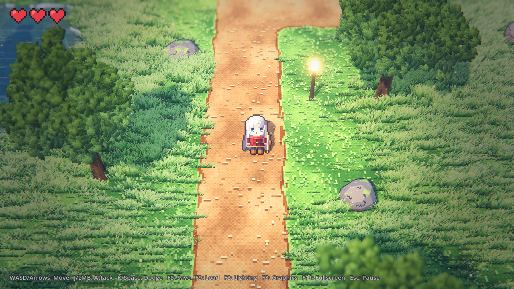
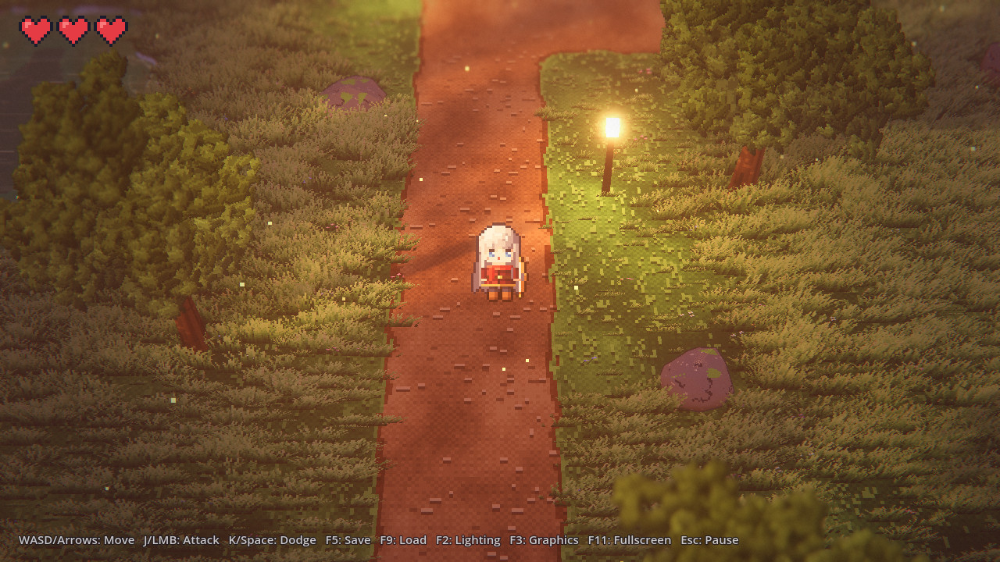
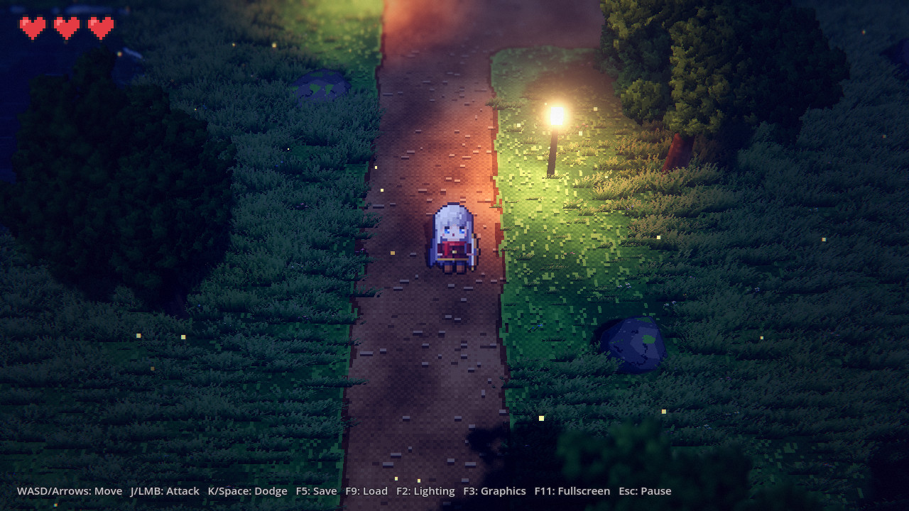
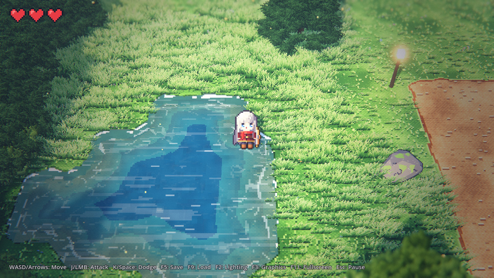

# GameTest – HD-2D Action RPG (Godot 4.7)

Prototype action RPG theo phong cách **HD-2D**: sprite pixel art billboard đặt trong thế giới 3D, cỏ dày đung đưa theo gió, camera nghiêng, DOF, bloom và volumetric fog.



| Hoàng hôn | Đêm |
|---|---|
|  |  |



## Chạy game

- **Editor:** mở Godot 4.7 → Import → chọn `project.godot` → bấm F5.
- **Dòng lệnh:** `godot --path .`

| Phím | Hành động |
|---|---|
| WASD / mũi tên / gamepad | Di chuyển |
| J / chuột trái / X | Tấn công |
| K / Space / B | Lướt né |
| F2 | Đổi preset ánh sáng (Day → Sunset → Night) |
| F3 | Đổi mức đồ họa (Low → Medium → High) |
| F5 / F9 | Lưu nhanh / tải nhanh (slot 0) |
| F4 | Bảng hiệu năng (chỉ bản debug) |
| F11 | Toàn màn hình |
| Esc | Tạm dừng |

**Tham số dev** (đặt sau `--`):

```bash
godot --path . -- --lighting=night                       # khởi động với preset Night
godot --path . -- --quality=low                          # khởi động với mức đồ họa Low
godot --path . -- --level=res://src/world/levels/...tscn # vào thẳng một level
godot --path . -- --pos=-9,3                             # đặt người chơi tại tọa độ x,z
godot --path . -- --screenshot=C:/tmp/shot.png --delay=3 # chụp màn hình rồi thoát
godot --path . -- --perf-overlay                         # bật sẵn bảng hiệu năng F4
godot --path . -- --bench=10 [--bench-out=C:/tmp/b.json] # bench: fullscreen, đo 10 s MỖI điểm đo, ghi JSON, thoát
```

## Mức đồ họa & hiệu năng

Game giới hạn **60 FPS** và tự giảm xuống 10 FPS khi cửa sổ mất focus, để GPU không chạy hết công suất. Mức đồ họa và giới hạn FPS được lưu trong `user://settings.cfg` (bench không ghi file này).

| Mức | Hiệu ứng | GPU / khung (1920×1080, RTX 3050 Ti · iGPU Radeon) |
|---|---|---|
| **High** | Đúng như level thiết kế: SSR, SSAO, volumetric fog, DOF, MSAA 2x; render 3D 100% | 6,5–7,1 ms · 34–37 ms |
| **Medium** | Render 3D 77% (upscale bilinear); tắt SSAO và MSAA; DOF, SSR, sương thể tích ở chất lượng thấp hơn | 4,7–4,9 ms · 15,5–16,8 ms |
| **Low** | Render 3D 60%; tắt SSR, SSAO, volumetric fog, DOF, MSAA; bóng đổ nhỏ hơn, ngắn hơn (×0,75); cỏ/hoa ½ mật độ và co dần ở xa; nước: đáy phẳng (không parallax), bỏ caustic | 2,7–3,7 ms · 6,0–6,6 ms |

Số đo Mốc 1 (plan `261125-1514-render-core-m1`, meadow_road day, 4 điểm đo; RTX Low dao động vì GPU hạ xung ở tải thấp). Xem mục **Đo hiệu năng**.
HUD/UI luôn ở độ phân giải gốc; chỉ phần 3D render nhỏ hơn rồi phóng lên.

Level chỉ cần bật hiệu ứng trong Environment như bình thường. `Settings` chỉ tắt hoặc giảm bớt theo mức đã chọn, không bao giờ bật thêm hiệu ứng mà level không dùng.

**Lưu ý khi làm map:**
- Đèn đặt trong group `lamps` và để tắt shadow. Shadow của omni light rất tốn, chỉ bật cho vài đèn quan trọng.
- GrassField tự chia ô 16×16 m (`chunk_size`) để frustum culling hoạt động — các ô là node con internal, không lưu vào `.tscn`. Đổi `cast_shadow` / `visibility_range` / material trên node cha trong editor thì bấm **Regenerate**.
- Cỏ/hoa đặt `visibility_range_end` ≈ 43 m (mép xa khung ≈ 31 m + nửa đường chéo ô); Low tự rút ngắn.
- Jolt Physics chỉ chấp nhận **scale đều** trên physics body (StaticBody/CharacterBody).

## Đo hiệu năng

```bash
python tools/bench/run_bench.py                    # meadow_road × low/medium/high × RTX/iGPU × day, so baseline
python tools/bench/run_bench.py --full             # + sunset/night + level stress (~25 phút)
python tools/bench/run_bench.py --gpus 0 --qualities low --seconds 3   # thử nhanh (trạng thái smoke)
python tools/bench/run_bench.py --full --update-baseline               # chụp lại docs/perf_baseline.json (phải cắm điện)
```

- Mỗi cấu hình là một lần chạy `godot -- --bench=N`: exclusive fullscreen 1920×1080, người chơi đứng ở từng `BenchPoint`
  (node đặt trong level, group `bench_points`), khởi động ≥ 60 khung + 1 s rồi đo N giây. Phím bị khóa trong lúc bench.
- Bảng: GPU p50 base → now, p95, CPU, draw, primitive, VRAM. `[ĐỎ]` khi GPU p50 chậm hơn **> 5 % VÀ > 0,3 ms** → exit 1.
  Điểm nhiễu (p95 > 1,05 × p50; iGPU 1,10) hoặc mất focus → tự chạy bù 1 lần. `smoke` = `--seconds` khác baseline (không so);
  `khác-môi-trường` = Godot/driver khác baseline (không tính đỏ, nên chụp lại baseline).
- **`[ĐỎ]` so baseline giữa các phiên chỉ là tín hiệu** (nhiệt, xung GPU laptop); kết luận "X làm chậm" phải dựa A/B cùng phiên.
- Không chạy hai lệnh Godot cùng lúc (run_bench từ chối khi có Godot đang chạy, kể cả editor). Không dùng máy khi đang bench.
- Level stress `src/world/levels/bench_stress/bench_stress.tscn` (96×96 m) = bản sao meadow + layout ghép 2×2
  (`python tools/art/gen_stress_layout.py`). Đổi cấu trúc `meadow_road.tscn` → sửa cả `bench_stress.tscn` + chạy
  `run_bench.py --stress --seconds 1` và `check.py --all` (`--import` không bắt `.tscn` hỏng).
- Overlay F4 / `--perf-overlay` dùng chung bộ đo (`PerfSampler`) với bench; tắt thì không tốn khung nào.

## Pipeline đồ họa

| Lớp | Nằm ở đâu | Chỉnh gì |
|---|---|---|
| Ánh sáng theo mood | `src/world/lighting/presets/*.tres` | Màu và góc mặt trời, bầu trời, ambient, sương, phơi sáng, glow, độ sáng đèn và hạt |
| Environment gốc | `src/world/environments/meadow_environment.tres` | Bật/tắt SSAO, SSR, glow, fog, volumetric fog, tonemap |
| DOF / ống kính | `src/world/camera/follow_camera.tscn` | `CameraAttributesPractical` (blur), FOV, khoảng cách, pitch |
| Hậu kỳ màn hình | `src/world/camera/post_process.gdshader` | Vignette, chromatic aberration, grain |
| Mặt đất | `src/world/terrain/terrain_ground_material.tres` | Mép đường, bóng mép, mảng màu loang, nền rừng |
| Nước | `src/world/terrain/water_material.tres` (+ `water_tint` / `water_sheen` trong preset) | Màu nông/sâu, độ trong, đáy hồ + caustics, bọt, sóng vào bờ, phản chiếu. Shader chỉ đọc + cuộn texture (`water_noise`/`water_sparkle` sinh bằng `gen_water.py`); mép hồ + khoảng cách bờ từ water field (`WaterField`, dựng lúc load từ layout, đất và nước dùng chung). Hook `ripple_texture`/`ripple_rect`/`ripple_strength` (mặc định tắt) cho gợn sóng sau này |
| Cây / rừng | `leaves_material.tres`, `pine_leaves_material.tres`, `bark_material.tres`, node `Foliage/Forest*` | Màu lá, số bậc sáng, ánh xuyên lá, gió; mật độ / scale rừng |
| Cỏ / hoa | `grass_card_material.tres`, `flower_card_material.tres`, node GrassField | Màu, gió, mật độ, chiều cao |

**Thêm mood mới** (ví dụ mưa, hang động): duplicate một preset `.tres`, chỉnh các giá trị, rồi thêm vào mảng `presets` của node `LightingDirector` trong level. Từ cutscene có thể gọi `set_preset_by_name("Night")`.

## Pixel art & bố cục map

**Bố cục map là một ảnh PNG nhỏ** (`meadow_road_layout.png`, 1 pixel = 1 m, tâm ảnh = gốc tọa độ):
- **Đỏ (R)** = đường đất, **xanh lá (G)** = cỏ cao, **xanh dương (B)** = nước, **trong suốt (A = 0, dùng tẩy)** = rừng.
- Mở bằng Pixelorama, tô màu rồi lưu lại. Godot tự import lại.
- Mặt đất, nước, tường va chạm, cỏ, hoa và rừng đều đọc chung ảnh này, nên luôn khớp nhau. Ô nước và ô rừng tự sinh tường chặn người chơi.
- File `.import` của ảnh layout phải để `process/fix_alpha_border=false`, nếu không ô trong suốt sẽ bị đổi màu.
- Trong editor bấm **Regenerate** trên node cỏ để rải lại. Khi chạy game thì cỏ tự sinh lại.

**Sinh pixel art bằng script Python (PIL):**
- `python tools/art/gen_terrain.py` sinh texture đất/cỏ, atlas bụi cỏ, hoa và ảnh layout vào `assets/art/environment/terrain/`. Chạy lại sẽ **ghi đè** file, nên sau khi sửa tay bằng Pixelorama thì đừng chạy lại (hoặc đổi tên file).
- `python tools/art/gen_water.py` sinh texture **dữ liệu** cho nước vào `assets/art/environment/water/` (không vẽ tay): `water_noise.png` (256×256, 32×32 ô value noise lát liền; R = noise, G/B = sai phân cho pháp tuyến gợn) và `water_sparkle.png` (white noise cho đốm lấp lánh). Deterministic (seed cố định); hằng `CELLS`/`DERIV_SCALE` phải khớp `water.gdshader`.
- `python tools/art/gen_character.py` sinh sprite sheet nhân vật chính (khung 32×32: idle/walk/attack/dodge/hurt × hướng down/up/side) và `src/entities/player/heroine_frames.tres`. Nhân vật được "rig" bằng khối hình trong script: sửa màu ở `PAL`, dáng ở `draw_front/draw_back/draw_side`, nhịp ở `anims()`. Màu sprite theo giờ trong ngày: `sprite_tint` trong preset ánh sáng (group `tinted_sprites`).

**Kích thước:**
- Texture mặt đất: 64×64, lát liền, 16 px = 1 m.
- Atlas bụi cỏ: 6 ô 32×24 xếp ngang. Số cột đặt bằng `atlas_columns` trong material.

**Cây** là 3D stylized: `TreeMeshBuilder` sinh thân/cành và tán gồm hàng trăm thẻ lá quay về camera.
- Thẻ lá dùng atlas xám `assets/art/environment/trees/leaves.png`; màu do material quyết định.
- Có 4 loài: sồi, sồi xòe, thông, bụi.
- Cây đặt lẻ dùng `tree.tscn`, chọn loài bằng `variant` và đổi dáng bằng `tree_seed`.
- Rừng là các `GrassField` kiểu Tree, mỗi node một loài. Bóng rừng đổ bằng proxy low-poly (`TreeMeshBuilder.get_shadow_proxy`, `shadow_proxy = true`), tán lá thật không đổ bóng.

## Quy ước code

- GDScript **typed** cho mọi biến, tham số và giá trị trả về. Project bật cảnh báo `untyped_declaration`.
- `class_name` cho các lớp dùng lại; autoload **không** có `class_name`.
- Code, scene và shader của cùng một tính năng nằm chung một thư mục trong `src/`. Asset thô (ảnh, âm thanh, font) để trong `assets/`; asset bên thứ ba phải ghi vào `CREDITS.md`.
- Node quan trọng trong scene dùng **unique name** (`%Name`).
- Cùng scene thì dùng signal trực tiếp. Khác hệ thống thì đi qua `EventBus`.
- Tiến trình cốt truyện lưu bằng **flag** trong `GameState` (`quest_`, `npc_`, `chest_`, `boss_defeated_`...).
- Đổi cấu trúc save: tăng `SAVE_VERSION` và thêm bước migrate trong `save_manager.gd`.
- Physics layers: 1 world · 2 player · 3 enemy · 4 player_hitbox · 5 enemy_hitbox · 6 interactable.
- Pixel art: 16 px = 1 m (`pixel_size = 0.0625`), filter Nearest, import Lossless (đã đặt mặc định trong project).

## Lộ trình

Roadmap chi tiết, ngân sách hiệu năng và checklist bắt buộc cho mọi tính năng: **[docs/PERFORMANCE_ROADMAP.md](docs/PERFORMANCE_ROADMAP.md)**.

1. ✅ Khung dự án, nhân vật, cỏ, camera, ánh sáng, mức đồ họa
2. Mốc 0–1: benchmark tự động, tối ưu lõi render (scale độ phân giải 3D, chia ô cỏ/rừng, bóng cây, nước)
3. Mốc 2: kẻ địch & boss (`HealthComponent` + `Hitbox`/`Hurtbox` + `StateMachine`) theo quy tắc sprite/LOD/pool
4. Mốc 3: khung skill & VFX 3D (`VfxPool`, warm-up shader) trước khi làm nhiều skill
5. Mốc 4: thế giới chia chunk, đồi/vách, prop MultiMesh
6. Hội thoại (addon **Dialogue Manager**), menu, âm thanh/nhạc, Mốc 5: loading & bản phát hành
